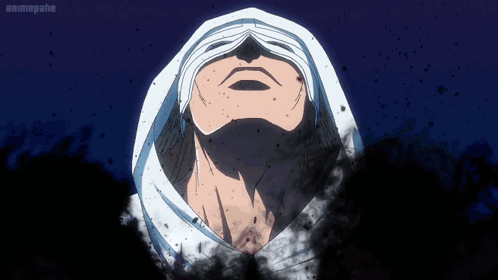
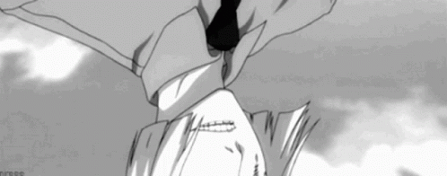

<!-- ═══════════════════  卍  B O X D E L T A  卍  ═══════════════════ -->

<div align="center">
  

  <br/>

  <a href="https://github.com/BoxDelta">
    
  </a>
</div>

<br/>



### ⛩️ 魂 // Soul

```yaml
name:      BoxDelta
os:        Arch Linux // GNOME
building:  Aether, a personal HQ
automates: n8n workflows in Docker
creating:  a faceless indie game channel
```

> *"Dark code. Sharp tools. No wasted motion."*

<br clear="right"/>

---

### ⚔️ 斬魄刀 // Zanpakutō

<div align="center">


<br/>


</div>

---

### 🩸 霊圧 // Reiatsu

<div align="center">


</div>

---

<div align="center">
  
  <br/>
  <sub>卍 &nbsp; BoxDelta &nbsp; 卍</sub>
</div>
